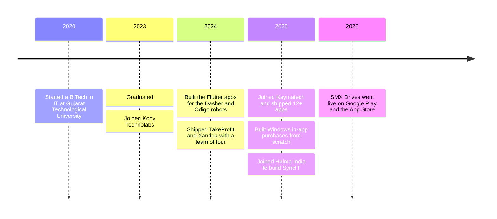
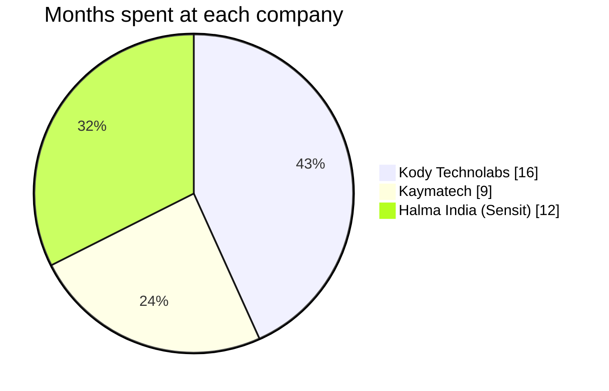
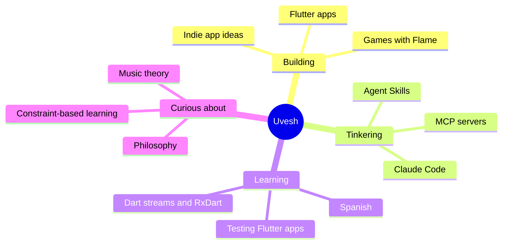
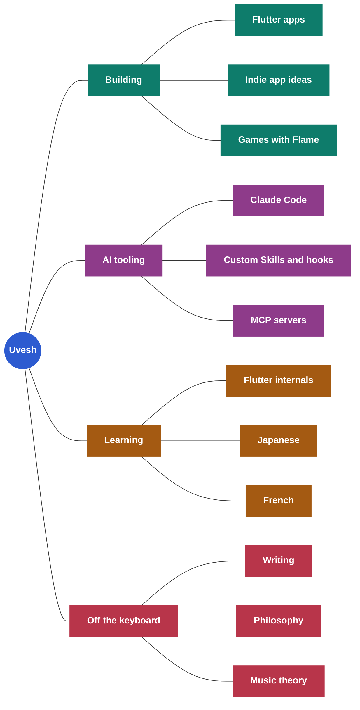
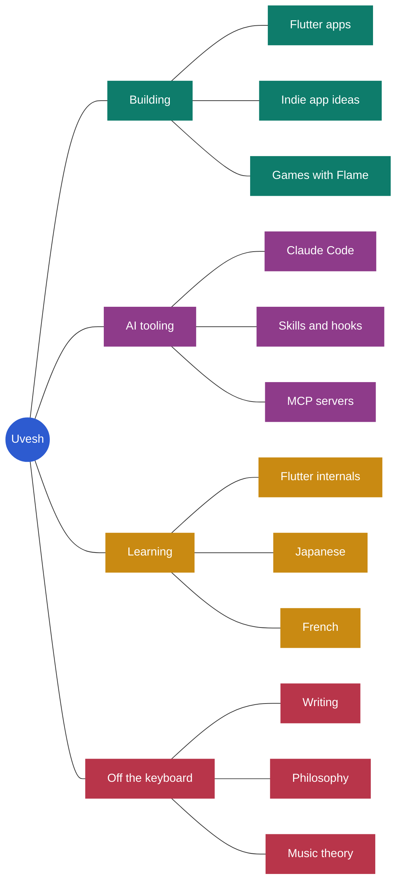

<!--
README VERSIONS
Older versions are kept in the comment blocks below, oldest first:
  v1 and v2: original drafts with stats widgets
  v3: Python and Android native focus
  v4: plain professional version
  v5: first colourful version with charts
  v6: more playful tone, mind-map chart
  v7: current live version, at the bottom of this file
To switch versions: wrap the live version in HTML comment markers, then
remove the markers around the version you want to use.

TODO for v7:
  - Add TakeProfit and Xandria store links if they are still live
  - Add 2-3 Kaymatech app store links you're allowed to share
  - Link QuickServe, SpeakUp and Atomic Dev Tools in the Side projects table (and pin them)
  - Add a "Writing" section with Medium/Substack links once the first posts are live
-->

<!-- 

### Hi there, I'm [Uvesh](https://www.linkedin.com/in/muhammaduvesh/) 👋

 
## 🚀 About Me

💙 Flutter Developer | Building smooth cross-platform apps with Dart.
Passionate about UI, performance & clean code.

    

  
   
Here are some ideas to get you started:
- 🔭 I’m currently working on Improving myself.
- 🌱 I’m currently exploring Philosophy.
- 💬 Ask me about Flutter or Anything about App Development.
- 📫 How to reach me: uveshmenpur.03@gmail.com
  
- 👯 I’m open to freelance and startup opportunities and excited to collaborate on meaningful projects that make a real difference.

 
 

-->
<!-- 

### Hi there, I'm [Uvesh](https://www.linkedin.com/in/muhammaduvesh/) 👋

## 🚀 About Me

💙 Flutter Developer focused on building smooth, efficient, and scalable cross-platform applications using Dart.

I’m passionate about creating clean user interfaces, optimizing app performance, and writing code that is maintainable and easy to scale. I enjoy learning new concepts, improving my development skills, and exploring better ways to build robust applications.

---

## 🛠️ Skills & Focus

- 📱 Cross-platform mobile development with Flutter  
- 🎨 UI/UX focused development  
- ⚡ Performance optimization and smooth user experience  
- 🧩 Writing clean, structured, and maintainable code  

---

## 🌱 Currently

- 🔭 Working on self-improvement and skill development  
- 🌱 Exploring philosophy and new ideas  
- 💬 Ask me about Flutter or mobile app development  

---

## 🤝 Opportunities

- 👯 Open to freelance and startup opportunities  
- 🚀 Interested in collaborating on meaningful and impactful projects  
- 📫 Reach me at: uveshmenpur.03@gmail.com  

### Hi there, I'm [Uvesh](https://www.linkedin.com/in/muhammaduvesh/) 👋

## 🚀 About Me

💙 Flutter Developer passionate about building smooth, scalable, and high-performance cross-platform applications using Dart.

I enjoy crafting clean user experiences, optimizing performance, and writing maintainable code that scales well over time. I believe in continuous improvement - both technically and personally - and actively work on refining my problem-solving approach and development practices.

Beyond coding, I explore philosophy and self-growth to build a stronger mindset, improve decision-making, and stay grounded while working on complex problems.

---

## 🛠️ What I Do

- 📱 Build cross-platform mobile applications using Flutter & Dart  
- 🎯 Focus on performance, responsiveness, and clean architecture  
- 🧠 Continuously improve coding standards and problem-solving skills  
- 🔍 Explore better ways to structure and scale applications  

---

## 🌱 Currently

- 🔭 Working on improving myself — both as a developer and as a thinker  
- 🌱 Exploring philosophy, mindset, and structured thinking  
- 💬 Open to discussions around Flutter, app development, and tech in general  

---

## 🤝 Let’s Connect

- 👯 Open to freelance and startup opportunities  
- 🚀 Excited to collaborate on meaningful projects that create real impact  
- 📫 Reach me at: uveshmenpur.03@gmail.com  

-->

<!-- ==================== v3 (previous live version) ====================

### Hi there, I'm [Uvesh](https://www.linkedin.com/in/muhammaduvesh/) 👋

## 🚀 About Me

💙 Flutter Developer passionate about building smooth, scalable, and high-performance cross-platform applications using Dart.

I enjoy crafting clean user experiences, optimizing performance, and writing maintainable code that scales well over time. Alongside Flutter, I have experience in Android Native development and am currently expanding my skill set by learning Python and exploring its frameworks.

I believe in continuous improvement - both technically and personally - and actively work on refining my problem-solving approach and development practices.

---

## 🛠️ What I Do

- 📱 Build cross-platform mobile applications using Flutter & Dart  
- 🤖 Explore Python and its frameworks to broaden development capabilities  
- 📲 Experience with Android Native development  
- 🎯 Focus on performance, responsiveness, and clean architecture  
- 🧠 Continuously improve coding standards and problem-solving skills  

---

## 🌱 Currently

- 🔭 Working on improving myself - both as a developer and as a thinker  
- 🌱 Exploring Python, frameworks, and philosophy  
- 💬 Open to discussions around Flutter, mobile development, and tech  

---

## 🤝 Let’s Connect

- 👯 Open to freelance and startup opportunities  
- 🚀 Excited to collaborate on meaningful projects that create real impact  
- 📫 Reach me at: uveshmenpur.03@gmail.com  

-->

<!-- ==================== v4 (previous live version, plain professional) ====================

## Hi, I'm Uvesh

Flutter engineer with 3 years of experience building cross-platform apps for Android, iOS, Windows and macOS. I care about apps that feel fast, stay maintainable as they grow, and ship reliably.

Currently a Software Engineer at **Halma India PLC** (Sensit Technologies), where I'm the primary developer on SyncIT, a multi-platform Flutter product built in a Melos monorepo with teams in India, Italy and the US.

### Shipped

| App | What it is | Links |
| --- | --- | --- |
| **SMX Drives** | Freelance. Companion app for an EV motor controller: live telemetry dashboard, ride modes, diagnostics and over-the-air firmware updates. | [Google Play](https://play.google.com/store/apps/details?id=com.smx.app) · [App Store](https://apps.apple.com/us/app/smx-drives/id6759551598) |
| **TakeProfit** | Subscription crypto-analytics app, built in a team of four at Kody Technolabs. | — |
| **Kaymatech portfolio** | 12+ consumer apps across Android, iOS, macOS and Windows, including the company's Windows in-app purchase infrastructure. | — |

### Side projects

| Project | Stack | Notes |
| --- | --- | --- |
| **QuickServe** | Flutter, Spring Boot, MySQL, Redis, Razorpay | Two-sided home-services marketplace with queue-based dispatch and server-verified payments |
| **SpeakUp** | Flutter, BLoC, ObjectBox, Hive | Offline-first spoken-English practice app, no account or internet needed |
| **Atomic Dev Tools** | Next.js, TypeScript, Turborepo | 44 browser-based developer utilities, almost all running fully client-side |

### Stack

**Mobile & desktop:** Flutter, Dart, Kotlin, platform channels, Android native  
**State & architecture:** BLoC, Riverpod, Provider, clean architecture, Melos monorepos  
**Data & backend:** Firebase, ObjectBox, Hive, SQLite, REST, WebSocket, Spring Boot, NestJS  
**Shipping:** GitHub Actions, CI/CD, Play Console, App Store Connect, Microsoft Store, RevenueCat  
**Workflow:** AI-assisted development with Claude Code, n8n automation

### Currently

- Going deeper on Dart streams, RxDart and state management, and on testing Flutter apps properly
- Building an offline-first capture-and-review app
- Learning Python and its frameworks

### Contact

[LinkedIn](https://www.linkedin.com/in/muhammaduvesh/) · [Portfolio](https://uveshmenpur.netlify.app/) · uveshmenpur.03@gmail.com

Open to conversations about Flutter roles and freelance work.
-->

<!-- ==================== v5 (first colourful version) ====================

  

  

  
  
  

## 👋 About me

I'm a Flutter engineer with three years of experience building cross-platform apps for Android, iOS, Windows and macOS. My work has taken me to some unusual places for a mobile developer: the touchscreens of service robots, desktop tools for gas-detection instruments, and the companion app for an electric motorcycle controller.

I'm currently a Software Engineer at **Halma India PLC** (Sensit Technologies), where I'm the primary developer on SyncIT.

Outside of work, I like learning things in slightly odd ways. I write poetry with banned-word rules, practise Dart by solving problems using only method chains, and read about music theory and philosophy.

## ⭐ Work I'm proud of

### 🧪 SyncIT · Sensit Technologies (Halma)

[Sensit](https://sensit-tech.com/gas-leak-detection-software/) has built gas-detection instruments for utilities, firefighters and hazmat teams for more than 40 years. SyncIT is its next-generation instrument management platform and the unified successor to its older SCAL-D and SCAL-N tools.

- Took SyncIT from proof of concept to production MVP as the primary developer: one Flutter codebase for Android, iOS and Windows that replaces several legacy apps.
- Structured it as a Melos monorepo with a shared core package and log-parsing SDK, so two product tiers, Lite (offline field use) and Plus (cloud sync and reporting), ship from one codebase.
- Proposed and built an automated instrument-settings tool covering 50+ options, cutting manual production effort by about 99%.
- Improved app performance by about 30–35% by reworking the local database schema and queries.
- Own the release pipeline across platforms and work daily with teams in India, Italy and the US.

### 📺 Odigo · Kody Technolabs

[Odigo](https://kodyrobots.com/) is Kody's AI-powered advertising robot for malls, airports and events, with large touchscreens and autonomous navigation. It was showcased at GITEX 2024 and has since been deployed at venues including LuLu Mall, DLF Mall and Jio World Drive.

- Delivered the Flutter app for Odigo's dual displays, connecting it to the robot's hardware through the ROS SDK, platform channels and Socket.IO.
- Enabled device-to-device communication over BLE and Android's Nearby Connections API.

### 🍽️ Dasher · Kody Technolabs

[Dasher](https://kodyrobots.com/) is Kody's autonomous serving robot for restaurants, offices and corporate events.

- Built the advertisement panel for Dasher's nine-panel system, with dynamic content scheduling and remote file transfer to the robot.

## 📱 Shipped apps

| App | What it is | Links |
| --- | --- | --- |
| **SMX Drives** | Freelance project. A companion app for an EV motor controller, with a live telemetry dashboard, ride modes, diagnostics and over-the-air firmware updates. | [Google Play](https://play.google.com/store/apps/details?id=com.smx.app) · [App Store](https://apps.apple.com/us/app/smx-drives/id6759551598) |
| **TakeProfit** | A subscription crypto-analytics app, built with a team of four at Kody Technolabs. | — |
| **Xandria** | The MVP of an eBook and audiobook platform, built with the same team. | — |
| **Kaymatech apps** | 12+ consumer apps across Android, iOS, macOS and Windows, averaging about 4,500 installs each. I also built the company's Windows in-app purchase system. | — |

## 🗺️ My journey so far

## 🧰 Tech I use

  
   
  
   
  

**Also:** BLoC, Riverpod, Provider, Melos, ObjectBox, Hive, Socket.IO, RevenueCat, Razorpay, Claude Code and n8n.

## 🧠 What's on my mind

## 🌱 Right now

- 📚 Going deeper on Dart streams, RxDart, state management and testing
- 🛠️ Building an offline-first app for capturing and reviewing everything on my mind
- 🤖 Experimenting with Claude Code, MCP servers and Agent Skills in my daily workflow
- 🇪🇸 Learning Spanish

## 🤝 Let's talk

I'm happy to chat about Flutter, cross-platform architecture, or apps that talk to hardware. I'm also open to freelance work.

📫 [uveshmenpur.03@gmail.com](mailto:uveshmenpur.03@gmail.com) · [LinkedIn](https://www.linkedin.com/in/muhammaduvesh/) · [Portfolio](https://uveshmenpur.netlify.app/)

  

-->

<!-- ==================== v6 (previous version, more playful tone) ====================

  

  

  
  
  

## 👋 About me

I've been building with Flutter for about three years. Most developers ship to phones. I've also shipped to the touchscreens of service robots, to Windows desktops that sync with gas-detection instruments, and to the companion app for an electric motorcycle's controller. That variety is what keeps me interested.

Right now I'm a Software Engineer at **Halma India PLC** (Sensit Technologies), where I'm the primary developer on SyncIT.

When I'm not coding, I'm usually writing or reading philosophy. I also like learning things with strange rules attached, like writing poems where certain words are banned, or solving Dart problems using nothing but method chains.

## ⭐ Work I'm proud of

### 🧪 SyncIT

`Sensit Technologies · Halma India` &nbsp; `2025 – present` &nbsp; `Android · iOS · Windows`

[Sensit](https://sensit-tech.com/gas-leak-detection-software/) has made gas-detection instruments for utilities, firefighters and hazmat teams for over 40 years. SyncIT is its next-generation instrument management platform, replacing the older SCAL-D and SCAL-N tools.

**What I did**
- Took it from a proof of concept to a production MVP as the primary developer, replacing several legacy apps with one Flutter codebase.
- Set it up as a Melos monorepo, so the Lite (offline field use) and Plus (cloud sync and reporting) tiers ship from one shared core.
- Proposed and built a tool that configures 50+ instrument settings automatically. Manual effort on the production line dropped by about 99%.
- Made the app 30–35% faster by reworking the local database schema and queries.

**Stack:** Flutter · Melos · ObjectBox · BLE, Wi-Fi and serial · CI/CD for three platforms

### 📺 Odigo

`Kody Technolabs` &nbsp; `2023 – 2025` &nbsp; `Android · robot hardware`

[Odigo](https://kodyrobots.com/) is an AI-powered advertising robot for malls, airports and events. It was showcased at GITEX 2024 and now runs in venues like LuLu Mall, DLF Mall and Jio World Drive.

**What I did**
- Built the Flutter app that runs on its two displays and talks to the robot's hardware.
- Wired Flutter to the robot through the ROS SDK, platform channels and Socket.IO.
- Added device-to-device communication over BLE and Android's Nearby Connections API.

**Stack:** Flutter · Kotlin · ROS SDK · Platform channels · Socket.IO

### 🍽️ Dasher

`Kody Technolabs` &nbsp; `2023 – 2025` &nbsp; `Android · robot hardware`

[Dasher](https://kodyrobots.com/) is an autonomous serving robot for restaurants, offices and corporate events.

**What I did**
- Built the advertisement panel in Dasher's nine-panel system.
- Added scheduling for dynamic content and remote file transfer, so new content reaches the robot without anyone touching it.

**Stack:** Flutter · Kotlin · Socket.IO · Background file transfer

## 📱 Other apps I've shipped

| App | What it is | Where |
| --- | --- | --- |
| **SMX Drives** | Freelance. Companion app for an EV motor controller: live telemetry, ride modes, diagnostics and over-the-air firmware updates. | [Google Play](https://play.google.com/store/apps/details?id=com.smx.app) · [App Store](https://apps.apple.com/us/app/smx-drives/id6759551598) |
| **TakeProfit** | Subscription crypto-analytics app, built in a team of four at Kody. | — |
| **Xandria** | eBook and audiobook platform. We built the MVP as the same team. | — |
| **Kaymatech apps** | 12+ consumer apps across Android, iOS, macOS and Windows, about 4,500 installs each on average. I also built the company's Windows in-app purchase system from scratch. | — |

## 🧪 Side projects

| Project | What it is | Built with |
| --- | --- | --- |
| **QuickServe** | A two-sided home-services marketplace. Orders are dispatched through a queue, and payments are verified on the server. | Flutter · Spring Boot · MySQL · Redis · Razorpay |
| **SpeakUp** | A spoken-English practice app that works with no account and no internet. | Flutter · BLoC · ObjectBox · Hive |
| **Atomic Dev Tools** | 44 small developer utilities in the browser. Almost all of them run entirely on your machine. | Next.js · TypeScript · Turborepo |

## 🗺️ How I got here

## 🧰 Tech I use

  
   
  
   
  

**Also:** BLoC, Riverpod, Provider, Melos, ObjectBox, Hive, Socket.IO, RevenueCat, Razorpay, Claude Code and n8n.

## 🧠 What's on my mind

## 🌱 Right now

- 🔬 **Taking Flutter apart.** I'm working through all three layers of its architecture (framework, engine and embedder) to understand how a widget actually becomes pixels on the screen.
- ✍️ **Writing.** I'm turning what I learn into posts about Flutter, the way I build software, and the occasional philosophical tangent.
- 🤖 **Living inside Claude Code.** Most of my day-to-day development runs through it. I write my own Skills and hooks, I've built MCP servers from scratch to understand the protocol properly, and I'm now designing a layer that sits between Claude Code and the developers who use it.
- 🗾 **Learning Japanese and French,** slowly and stubbornly.

## 🤝 Let's talk

If you want to talk about Flutter, how it works under the hood, apps that talk to hardware, or AI-assisted development, my inbox is open. I'm also open to freelance work.

📫 [uveshmenpur.03@gmail.com](mailto:uveshmenpur.03@gmail.com) · [LinkedIn](https://www.linkedin.com/in/muhammaduvesh/) · [Portfolio](https://uveshmenpur.netlify.app/)

  

-->

<!-- ==================== v7 (current live version, October 2026) ==================== -->

  

  

  
  
  

## 👋 About me

I've been building with Flutter for about three years. Most developers ship to phones. I've also shipped to the touchscreens of service robots, to Windows desktops that sync with gas-detection instruments, and to the companion app for an electric motorcycle's controller. That variety is what keeps me interested.

Right now I'm a Software Engineer at **Halma India PLC** (Sensit Technologies), where I'm the primary developer on SyncIT.

When I'm not coding, I'm usually writing or reading philosophy. I also enjoy learning with constraints, like writing poems with banned words or solving Dart problems using only method chains.

## ⭐ Work I'm proud of

### 🧪 SyncIT

`Sensit Technologies · Halma India` &nbsp; `2025 – present` &nbsp; `Android · iOS · Windows`

[Sensit](https://sensit-tech.com/gas-leak-detection-software/) has made gas-detection instruments for utilities, firefighters and hazmat teams for over 40 years. SyncIT is its next-generation instrument management platform, replacing the older SCAL-D and SCAL-N tools.

**What I did**
- Took it from a proof of concept to a production MVP as the primary developer, replacing several legacy apps with one Flutter codebase.
- Set it up as a Melos monorepo, so the Lite (offline field use) and Plus (cloud sync and reporting) tiers ship from one shared core.
- Proposed and built a tool that configures 50+ instrument settings automatically. Manual effort on the production line dropped by about 99%.
- Made the app 30–35% faster by reworking the local database schema and queries.

**Stack:** Flutter · Melos · ObjectBox · BLE, Wi-Fi and serial · CI/CD for three platforms

### 📺 Odigo

`Kody Technolabs` &nbsp; `2023 – 2025` &nbsp; `Android · robot hardware`

[Odigo](https://kodyrobots.com/) is an AI-powered advertising robot for malls, airports and events. It was showcased at GITEX 2024 and now runs in venues like LuLu Mall, DLF Mall and Jio World Drive.

**What I did**
- Built the Flutter app that runs on its two displays and talks to the robot's hardware.
- Wired Flutter to the robot through the ROS SDK, platform channels and Socket.IO.
- Added device-to-device communication over BLE and Android's Nearby Connections API.

**Stack:** Flutter · Kotlin · ROS SDK · Platform channels · Socket.IO

### 🍽️ Dasher

`Kody Technolabs` &nbsp; `2023 – 2025` &nbsp; `Android · robot hardware`

[Dasher](https://kodyrobots.com/) is an autonomous serving robot for restaurants, offices and corporate events.

**What I did**
- Built the advertisement panel in Dasher's nine-panel system.
- Added scheduling for dynamic content and remote file transfer, so new content reaches the robot without anyone touching it.

**Stack:** Flutter · Kotlin · Socket.IO

## 📱 Other apps I've shipped

| App | What it is | Where |
| --- | --- | --- |
| **SMX Drives** | Freelance. Companion app for an EV motor controller: live telemetry, ride modes, diagnostics and over-the-air firmware updates. | [Google Play](https://play.google.com/store/apps/details?id=com.smx.app) · [App Store](https://apps.apple.com/us/app/smx-drives/id6759551598) |
| **TakeProfit** | Subscription crypto-analytics app, built in a team of four at Kody. | — |
| **Xandria** | eBook and audiobook platform. We built the MVP as the same team. | — |
| **Kaymatech apps** | 12+ consumer apps across Android, iOS, macOS and Windows, about 4,500 installs each on average. I also built the company's Windows in-app purchase system from scratch. | — |

## 🧪 Side projects

| Project | What it is | Built with |
| --- | --- | --- |
| **QuickServe** | A two-sided home-services marketplace. Orders are dispatched through a queue, and payments are verified on the server. | Flutter · Spring Boot · MySQL · Redis · Razorpay |
| **SpeakUp** | A spoken-English practice app that works with no account and no internet. | Flutter · BLoC · ObjectBox · Hive |
| **Atomic Dev Tools** | 44 small developer utilities in the browser. Almost all of them run entirely on your machine. | Next.js · TypeScript · Turborepo |

## 🗺️ How I got here

## 🧰 Tech I use

**Mobile**

  

BLoC · Riverpod · Provider · Melos · ObjectBox · Hive · Platform channels · BLE · RevenueCat · Razorpay

**Backend and web**

  

**Databases and tools**

  

Socket.IO · Claude Code · n8n

## 🧠 What's on my mind

## 🌱 Right now

- 🔬 Exploring how Flutter works internally, across the framework, engine and embedder layers.
- ✍️ Writing about Flutter, how I approach building software, and now and then, philosophy.
- 🤖 Using Claude Code as a core part of my workflow, with my own Skills, hooks and MCP servers. I'm also designing a layer that sits between Claude Code and the developers who use it.
- 🗾 Learning Japanese and French.

## 🤝 Let's talk

I'm always happy to talk about Flutter, apps that work with hardware, or AI-assisted development. I'm also open to freelance work.

📫 [uveshmenpur.03@gmail.com](mailto:uveshmenpur.03@gmail.com) · [LinkedIn](https://www.linkedin.com/in/muhammaduvesh/) · [Portfolio](https://uveshmenpur.netlify.app/)

  

