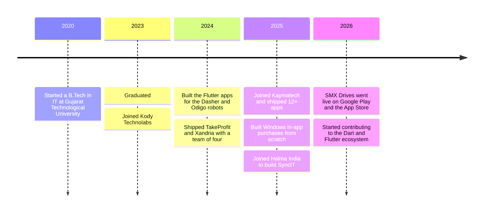

  

  

  
  
  

## 👋 About me

I've been building with Flutter for about three years. Most developers ship to phones. I've also shipped to the touchscreens of service robots, to Windows desktops that sync with gas-detection instruments, and to the companion app for an electric motorcycle's controller. That variety is what keeps me interested.

Right now I'm a Software Engineer at **Halma India PLC** (Sensit Technologies), where I'm the primary developer on SyncIT.

When I'm not coding, I'm usually writing or reading philosophy. I also enjoy learning with constraints, like writing poems with banned words or solving Dart problems using only method chains.

## ⭐ Notable work

### 🧪 SyncIT

`Sensit Technologies · Halma India` &nbsp; `2025 – present` &nbsp; `Android · iOS · Windows`

[Sensit](https://sensit-tech.com/gas-leak-detection-software/) has made gas-detection instruments for utilities, firefighters and hazmat teams for over 40 years. SyncIT is its next-generation instrument management platform, consolidating several older Sensit applications into one cross-platform product.

**My role:** Primary developer, working with a 25–30 person team across software, firmware, hardware, QA, project management and marketing in Ahmedabad, Valparaiso (Indiana, USA) and Bolzano (Italy).

**What I did**
- Took SyncIT from a proof of concept to a production-ready MVP, and kept evolving it through new features, architectural improvements and client-driven changes.
- Structured it as a Melos monorepo with two product variants: SyncIT Lite (offline-first, for field evaluation) and SyncIT Plus (cloud sync, advanced reporting and premium integrations), built on a shared core package and a dedicated log-parsing SDK.
- Built the device communication modules: BLE for gas-detection instruments, and Wi-Fi, LAN and serial for calibration stations, covering log download, parsing, visualization, firmware update workflows and multi-format export.
- Suggested and built a settings application for three instruments, with an automated BLE update flow across 50 settings. Working with the firmware team, this cut manual production effort by about 99%.
- Improved app performance by about 30–35% by optimizing the database schema and queries.
- Reworked the app's UI, navigation flow and data visualization, creating wireframes with the engineering manager.
- Built Windows-scheduled reporting for LAN-connected devices, with customizable export configurations.
- Own the full release pipeline, from build generation and versioning to packaging and distribution on every platform.

**Stack:** Flutter · Dart · Melos · ObjectBox · BLE · Wi-Fi, LAN and serial · n8n · Claude Code

### 📺 Odigo

`Kody Technolabs` &nbsp; `2023 – 2025` &nbsp; `Android · robot hardware`

[Odigo](https://kodyrobots.com/) is an advertising robot with dual mirrored displays and centralized control. It was showcased at GITEX 2024 and now runs in venues like LuLu Mall, DLF Mall and Jio World Drive.

**What I did**
- Worked on the Flutter app that drives Odigo's dual mirrored displays and centralized control.
- Connected the app to the robot through the ROS SDK, platform channels and Socket.IO.

**Stack:** Flutter · Kotlin/Java · Platform channels · ROS SDK · Socket.IO

### 🍽️ Dasher

`Kody Technolabs` &nbsp; `2023 – 2025` &nbsp; `Android · robot hardware`

[Dasher](https://kodyrobots.com/) is a multi-display delivery robot built on a platform of nine integrated panels.

**What I did**
- Worked as one of the core developers on the Dasher platform.
- Was the primary developer of the Advertisement Panel, building dynamic content scheduling and remote file transfer to the robot.

**Stack:** Flutter · Android native · MVVM and DDD

At Kody, I also worked across Flutter and native Android layers, integrating BLE and Android's Nearby Connections API for device-to-device communication.

## 🔧 Open source

I fix bugs and fill documentation gaps in the Dart and Flutter ecosystem. Merged so far:

| Project | What I fixed |
| --- | --- |
| [Riverpod](https://github.com/rrousselGit/riverpod) | [Allow build 5 in riverpod_generator](https://github.com/rrousselGit/riverpod/pull/4945) · [Make the AsyncValueIsLoadingException constructor public](https://github.com/rrousselGit/riverpod/pull/4944) |
| [Serverpod](https://github.com/serverpod/serverpod) | [Skip error reporting when sending on an already closed method stream websocket](https://github.com/serverpod/serverpod/pull/5905) |
| [Drift](https://github.com/simolus3/drift) | [Remove the comma left after a moved insert mode argument](https://github.com/simolus3/drift/pull/3890) |
| [Freezed](https://github.com/rrousselGit/freezed) | [Enable freezed_lint in the Freezed example](https://github.com/rrousselGit/freezed/pull/1383) |
| [shelf](https://github.com/dart-lang/shelf) | [shelf_static: ignore invalid If-Modified-Since headers](https://github.com/dart-lang/shelf/pull/557) |
| [dart-lang/tools](https://github.com/dart-lang/tools) | [boolean_selector: print `\|\|` in UnionSelector.toString()](https://github.com/dart-lang/tools/pull/2735) |
| [Patrol](https://github.com/leancodepl/patrol) | [Resolve dependencies in gen_from_schema](https://github.com/leancodepl/patrol/pull/3330) · [Document the --ios option for iOS Simulator runs](https://github.com/leancodepl/patrol/pull/3327) |
| [marionette_mcp](https://github.com/leancodepl/marionette_mcp) | [Time out connect when the VM service stops answering](https://github.com/leancodepl/marionette_mcp/pull/143) |
| [mobile_scanner](https://github.com/juliansteenbakker/mobile_scanner) | [Opt in to experimental CameraX APIs so lintDebug passes](https://github.com/juliansteenbakker/mobile_scanner/pull/1852) |
| [very_good_test_runner](https://github.com/VeryGoodOpenSource/very_good_test_runner) | [Parse test events split across stdout chunks](https://github.com/VeryGoodOpenSource/very_good_test_runner/pull/66) |
| [Heartry](https://github.com/SirusCodes/Heartry) | [Wait for shared images to be written before sharing](https://github.com/SirusCodes/Heartry/pull/19) · [Keep changelog dialog buttons visible on narrow screens](https://github.com/SirusCodes/Heartry/pull/18) |
| [BitChord](https://github.com/kushagrasinghx/BitChord) | [Fix the outside shuffle buttons](https://github.com/kushagrasinghx/BitChord/pull/1554) · [Add a setting to hide the Listen Together pill](https://github.com/kushagrasinghx/BitChord/pull/906) · [Point the swipe hint the right way](https://github.com/kushagrasinghx/BitChord/pull/905) · [Treat KuGou's instrumental notice as no lyrics](https://github.com/kushagrasinghx/BitChord/pull/898) |

More are in review at Flutter, dart-lang, Bloc, Mason, Dio, Freezed and Patrol. [See all my pull requests](https://github.com/search?q=author%3Auveshm003+is%3Apr+-user%3Auveshm003&type=pullrequests&s=created&o=desc).

Achievements are on my <a href="https://community.vaunt.dev/board/uveshm003/achievements">Vaunt board</a>.

## 📱 Other apps I've shipped

| App | What it is | Where |
| --- | --- | --- |
| **SMX Drives** | Freelance. Companion app for an EV motor controller: live telemetry, ride modes, diagnostics and over-the-air firmware updates. | [Google Play](https://play.google.com/store/apps/details?id=com.smx.app) · [App Store](https://apps.apple.com/us/app/smx-drives/id6759551598) |
| **TakeProfit** | Subscription crypto-analytics app, built in a team of four at Kody. | — |
| **Xandria** | eBook and audiobook platform. We built the MVP as the same team. | — |
| **Kaymatech apps** | 12+ utility apps across Android, iOS, macOS, Windows and Linux, averaging 4,000–5,000 installs and a 5–6% premium conversion rate. I designed the company's Windows in-app purchase infrastructure, built its entire Windows portfolio, and ran a web-purchase experiment with two products when RevenueCat added web support. | — |

## 🧪 Side projects

| Project | What it is | Built with |
| --- | --- | --- |
| **[Encore](https://github.com/uveshm003/encore)** | An offline audio studio. Import a song, strip the vocal on-device, sing over the backing, then mix and export. | Flutter · ONNX Runtime |
| **[Cairn](https://github.com/uveshm003/cairn)** | A private recorder for audio and video entries, with tags and search. It makes no network requests at all. | Flutter |
| **[Clearing](https://github.com/uveshm003/clearing)** | A calm, offline-first Android app for closing your mental tabs: capture, clarify, plan, close. | Flutter |
| **[SpeakUp](https://github.com/uveshm003/speakup)** | A spoken-English practice app that works with no account and no internet. | Flutter · BLoC · ObjectBox · Hive |
| **[DevAccess](https://github.com/uveshm003/devaccess)** | A developer options and device insight hub for Android. | Flutter · Kotlin |
| **[Compass](https://github.com/uveshm003/compass)** | A Claude Code plugin and local CLI that routes work to the cheapest executor that can do it correctly, and makes AI changes reviewable. | Python · tree-sitter · MCP |
| **[AI Dev Toolkit](https://github.com/uveshm003/ai-dev-toolkit)** | The best skills, plugins, MCP servers and workflows for AI coding agents, ranked and explained. | Markdown |
| **QuickServe** | A two-sided home-services marketplace. Orders are dispatched through a queue, and payments are verified on the server. | Flutter · Spring Boot · MySQL · Redis · Razorpay |
| **Atomic Dev Tools** | 44 small developer utilities in the browser. Almost all of them run entirely on your machine. | Next.js · TypeScript · Turborepo |

## 🗺️ How I got here

## 🧰 Tech I use

**Mobile**

  

BLoC · Riverpod · Provider · Melos · ObjectBox · Hive · Platform channels · BLE · RevenueCat · Razorpay

**Backend and web**

  

**Databases and tools**

  

Socket.IO · Claude Code · n8n

## 🌱 Right now

- 🔬 Exploring how Flutter works internally, across the framework, engine and embedder layers.
- ✍️ Writing about Flutter, how I approach building software, and now and then, philosophy.
- 🤖 Using Claude Code as a core part of my workflow, with my own Skills, hooks and MCP servers. I'm also designing a layer that sits between Claude Code and the developers who use it.
- 🗾 Learning Japanese and French.

## 🤝 Let's talk

I'm always happy to talk about Flutter, apps that work with hardware, or AI-assisted development. I'm also open to freelance work.

📫 [uveshmenpur.03@gmail.com](mailto:uveshmenpur.03@gmail.com) · [LinkedIn](https://www.linkedin.com/in/muhammaduvesh/) · [Portfolio](https://uveshmenpur.netlify.app/)

  

